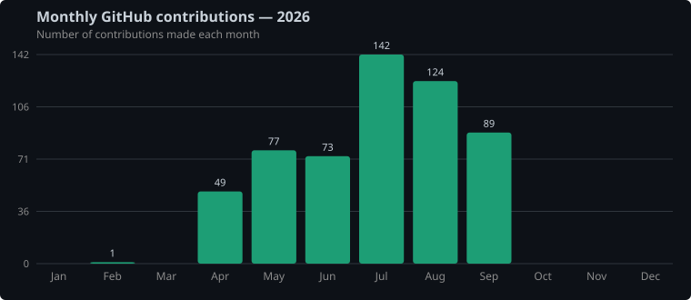

# 👋 Hi, I'm GOPIKA SATHISHBABU

### 🚀 Aspiring Software Engineer | AI Engineer | Web Developer

**Computer Science Engineering Undergraduate | Full-Stack Development | Artificial Intelligence**

Passionate about transforming ideas into meaningful digital solutions through **Software Engineering, Artificial Intelligence, and Modern Web Technologies**.

I enjoy building real-world applications, exploring AI-powered solutions, and turning complex problems into practical, user-friendly experiences.

Currently strengthening my skills in **Python, Backend Development, AI Integration, and Problem-Solving**, while gaining hands-on experience through internships, hackathons, and client projects.

---

## 🚀 About Me

- 🎓 **B.E. Computer Science Engineering Student** | 2nd Year
- 💻 Passionate about **Full-Stack Web Development & Software Engineering**
- 🤖 Exploring **Artificial Intelligence, AI Integration & Intelligent Applications**
- 🌱 Currently learning **Python, Backend Development & AI Technologies**
- 💼 **Freelance Developer** — Building real-world web and AI solutions for clients
- 🛠️ Interested in creating practical applications beyond tutorial projects
- 🏆 Participating in **Hackathons, Technical Challenges & Collaborative Projects**
- 🎯 Career Goal: **Software Engineer / AI Engineer / Web Developer**

---

## 💼 Experience & Learning

### 💻 Full-Stack Development Intern | Upskill
**2026**

- Developed a full-stack project management application using React, Node.js, Express.js, and MongoDB.
- Worked on REST APIs, authentication, interactive dashboards, and task management features.
- Gained hands-on experience with frontend and backend integration.

### 🌐 Web Development Intern | Interne
**Jan 2024 – Mar 2024**

- Developed responsive web pages using HTML, CSS, and JavaScript.
- Built dynamic UI components and improved mobile compatibility.
- Focused on web performance and interactive user experiences.

### 🎨 Frontend Development Intern | CodeSoft
**Mar 2024 – May 2024**

- Built responsive frontend projects using modern web design principles.
- Strengthened JavaScript and interactive UI development skills.
- Worked on user-friendly layouts and interfaces.

### 🤖 AI Intern | CodeAlpha & Oasis Infobyte
**May 2024 – Aug 2024**

- Explored machine learning fundamentals and AI application development.
- Developed AI-focused mini-projects and application prototypes.
- Applied UI/UX principles to improve usability.

### 💼 Freelance Web Development | Real-World Client Projects

- Developing and maintaining real-world web applications for clients.
- Working with authentication, database integration, API services, and deployment.
- Gaining practical experience in requirement analysis, troubleshooting, and project delivery.

---

## 🚀 Featured Projects

### 🏡 01. Jay Promoters — Real Estate Web Platform

A real-world client project developed to simplify property discovery, customer enquiries, and real-estate business operations.

- Responsive property listing and information pages
- Customer enquiry forms and database integration
- Supabase-powered backend workflows
- Website deployment, domain configuration, and rebranding

**Tech Stack:** HTML, CSS, JavaScript, Supabase, Vercel

🔗 [Live Website](https://www.jaypromoters.com/)

---

### 🎓 02. EduPulse — AI-Powered Learning Platform

An AI-integrated educational platform designed to improve student engagement, assessments, and classroom management.

- AI-powered quiz generation and assessments
- Live quizzes, attendance management, and student analytics
- AI interview practice and interactive learning features
- Gamification, performance tracking, and dashboards

**Tech Stack:** HTML, CSS, JavaScript, Supabase, Groq AI

🔗 [GitHub Repository](https://github.com/gopicode777/sincet) | [Live Demo](https://sincet.vercel.app/)

---

### 📝 03. AI Question Paper Generator

An AI-assisted academic tool designed to help educators generate structured question papers and simplify assessment preparation.

- AI-assisted question generation
- Structured academic question-paper creation
- PDF question-paper generation
- Developed as part of the EduPulse platform

**Focus:** Artificial Intelligence, Educational Technology, PDF Generation

🔗 [GitHub Repository — EduPulse](https://github.com/gopicode777/sincet)

---

### 🎤 04. SpeakRate — AI Communication & Interview Practice

An AI-powered platform focused on improving English communication and interview preparation.

- English speaking and communication practice
- AI-assisted learning experiences
- Interview preparation features
- Interactive, user-friendly web interface

**Focus:** AI Integration, Communication Skills, Web Development

---

### 💬 05. ChatFluent — AI English Speaking Practice

An AI-powered English speaking practice platform designed to support language learning and communication development.

- AI-assisted English communication practice
- Interactive language-learning experience
- Focus on improving speaking confidence and fluency

**Focus:** Artificial Intelligence, Language Learning, Web Development

---

### 👁️ 06. Real-Time Object Detection

A browser-based computer vision application that uses camera input for real-time object detection.

- Live camera-based object detection
- Interactive detection results
- Browser-based computer vision experience

**Tech Stack:** JavaScript, Browser APIs, Computer Vision

---

### 🤖 07. A2Z Nexus — Multi-AI Agent Application

A collaborative AI-powered application developed during the IBM Bob 2.0 hackathon.

- Multi-AI agent application concept
- AI-powered workflows
- Collaborative development and rapid prototyping
- Practical experience in hackathon-based problem-solving

**Focus:** Artificial Intelligence, AI Agents, Team Collaboration

🔗 [GitHub Repository](https://github.com/gopicode777/A2Z-Nexus) | [Live Demo](https://a2znexus.vercel.app/login.html)

---

### 📊 08. TaskFlow — Full-Stack Project Management

A full-stack task management application developed during an internship.

- Project and task management dashboard
- User authentication and backend APIs
- Task tracking and analytics
- Database integration

**Tech Stack:** React, Tailwind CSS, Node.js, Express.js, MongoDB, JWT

🔗 [GitHub Repository](https://github.com/gopicode777/upskill-intern-full-stack)

---

### 🌍 09. NILAM — AI-Powered Land Audit Platform
**Status: In Development**

An AI-assisted property and land assessment platform exploring document analysis, location intelligence, and property information workflows.

- Map-based property exploration
- Document management and analysis workflows
- AI-assisted land information and assessment features
- Ongoing platform development and integration

**Focus:** AI Integration, GIS, Document Analysis, Real Estate Technology

🔗 [Live Prototype](https://nilam-gules.vercel.app/#/map)

---

## 💻 Tech Stack

    

   

  

 

      

---

## 📊 GitHub Stats

 

---

## 📫 Connect With Me

- 💼 LinkedIn: [GOPIKA SATHISHBABU](https://www.linkedin.com/in/gopika037cse/)
- 🌐 Portfolio: [Gopika S | Portfolio](https://gopicode777.github.io/portfolio-website/#home)
- 📧 Email: gopikasgopikas143@gmail.com

---

⭐ Thanks for visiting my profile!

